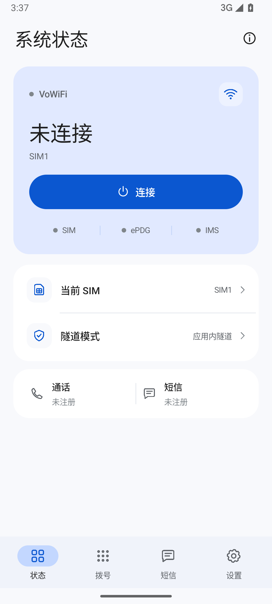
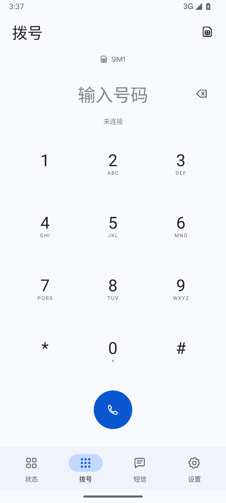
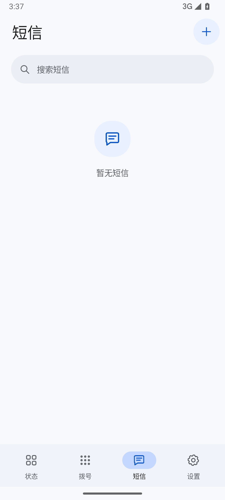
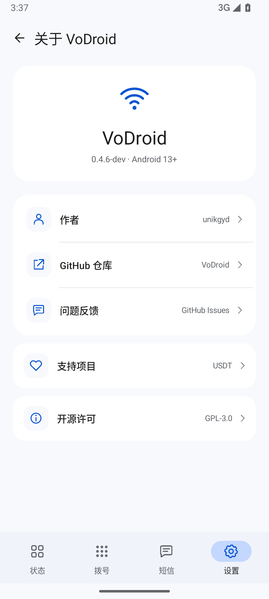

# VoDroid

[](https://github.com/unikgyd/VoDroid/actions/workflows/ci.yml)
[](https://github.com/unikgyd/VoDroid/releases)

[](LICENSE)

**可插拔 eSIM 管理与软件 VoWiFi 客户端。** Android 13 及以上，支持 arm64-v8a / x86_64。由 [unikgyd](https://github.com/unikgyd) 开发。

通过手机卡槽的 **OMAPI** 访问 SIM / 可插拔 eUICC，在应用内完成 ePDG、IKEv2、SIM 鉴权与 IMS 通信。兼容 USB CCID；Root、Magisk 和 LSPosed 作为独立的可选增强。

当前为持续开发版本。DITO 实机已验证鉴权、IMS 注册、SA 换钥和短信接收；更多运营商、真实双向通话与配置下载仍需验证。详细范围见 [兼容性与验证状态](docs/COMPATIBILITY.md)。

| 状态 | 拨号 | 短信 | 关于 |
| --- | --- | --- | --- |
|  |  |  |  |

模拟器截图，无真实卡片或消息数据。

## 主要功能

- **四页界面**：状态、拨号、短信、设置；首页集中显示 SIM / ePDG / IMS 状态，点击隧道模式直接进入设置。
- **卡片管理**：检测 OMAPI Reader、读取身份与 EID、列出 eSIM 配置，提供下载、启停、切换、昵称和删除入口。
- **软件 VoWiFi**：ePDG 自动发现与手动覆盖，IKE 套件兼容策略，EAP-AKA / AKA′、IKE 分片及 SA 换钥。
- **通话与短信**：应用内拨号、来电界面、通知、会话和本地历史；支持 SIP / RTP、SMS over IMS。
- **可选增强**：Root APDU、系统通话账户、系统短信集成、eSIM 能力声明与安装链接转接，统一位于「设置 → 可选增强 → Root 与模块」。

“VoWiFi”不要求当前网络一定是 Wi-Fi。蜂窝网络或已有 VPN 也可以承载外层连接，前提是运营商允许、线路能访问 ePDG 且 UDP 通畅。

## 下载与开始使用

从 [GitHub Releases](https://github.com/unikgyd/VoDroid/releases) 下载 APK。普通使用只安装 APK；`vodroid-magisk-*.zip` 是需要重启的可选系统模块。

1. 插入 SIM / 可插拔 eUICC，打开「设置 → SIM 与 eSIM → 卡片通道」。默认使用 OMAPI，检测并选择实际 Reader。
2. 通过「检测卡片」确认 USIM 和 eSIM 管理通道。普通 SIM 可能支持鉴权，但不支持配置下载；OMAPI 仍受系统与卡片访问规则约束。
3. 保持默认「应用内隧道」，按需填写运营商 SMSC。自动发现失败时再覆盖 ePDG、MNC 位数或 P-CSCF。
4. 手机需要其他 VPN 时先连接该 VPN，再开启 VoDroid。确认 SIM、ePDG 和 IMS 状态后使用拨号或短信。
5. 管理 eSIM 配置前先断开 VoWiFi。需要系统集成时，再按 [可选增强说明](docs/USAGE.md#rootmagisk-与-lsposed) 单独配置。

SIM / eSIM 必须已开通运营商 Wi-Fi Calling。VoDroid 不代办运营商开户、entitlement 或紧急地址登记。

## 两种隧道

| 模式 | Android VPN 槽位 | 适用情况 |
| --- | --- | --- |
| 应用内隧道（默认） | 不占用 | 应用自己的 IPv4 / UDP / TCP 网络栈；可以沿已有 VPN 的路由连接 ePDG |
| 系统 VPN / TUN | 占用，需要系统授权 | 由 VoDroid 建立 Android VPN，只有本应用流量进入 TUN |

两种模式都连接运营商 ePDG。切换模式后需重新连接。已有 VPN 的应用排除、锁定规则或 UDP 限制会影响可达性。

## 构建

需要 **JDK 17、Android SDK 35、Build Tools 35.0.0、NDK 28.2.13676358、Python 3.10+**。Gradle 8.14.3 由已固定校验和的 Wrapper 下载。

```sh
git clone --recurse-submodules https://github.com/unikgyd/VoDroid.git
cd VoDroid
```

配置 `ANDROID_HOME`，或在本机 `local.properties` 中填写 `sdk.dir`。该文件不会提交。

Windows PowerShell：

```powershell
.\scripts\build.ps1
```

Linux / macOS：

```sh
./gradlew --no-daemon :core:test :app:assembleDebug :app:lintDebug
python3 scripts/package.py --variant debug
```

输出位于 `artifacts/`：调试 APK、配套 Magisk 模块、构建信息和 SHA-256 校验文件。已克隆但未拉取依赖时执行 `git submodule update --init --recursive`。更多环境及测试说明见 [开发指南](docs/DEVELOPMENT.md)。

## 自动构建与发布

- 提交到 `main` 或发起 PR：运行协议测试、APK 构建、Lint 和打包校验，上传调试产物及报告。
- 推送 `v*` 版本标签：使用固定发布签名构建，自动发布 **APK、Magisk 模块、包含原生依赖的完整源码包、构建信息和校验和**。
- 含 `-` 的标签会标记为预发布；缺少签名或版本不匹配时停止发布。

首次发布需配置四项仓库签名 Secrets。密钥生成、导入及标签发布步骤见 [发布指南](docs/RELEASING.md)。调试版与正式版签名不同，不能直接覆盖安装。

## 项目结构

| 目录 | 内容 |
| --- | --- |
| `app/` | Android 界面、前台服务、音频、卡片通道、系统集成 |
| `core/` | 独立 Java 协议核心与 JVM 测试 |
| `lpac/` | OpenEUICC USB / JNI 适配及固定版本原生依赖 |
| `hidden-api/`、`hook-api/` | 仅供编译的 Android / Xposed 类型声明 |
| `magisk/` | 可选系统模块模板 |
| `diagnostics/hook-probe/` | 独立的 eSIM 兼容诊断应用，不包含在主 APK 内 |
| `scripts/`、`.github/` | 本地构建、签名、打包及自动发布 |

设备日志、截图、安装包、参考仓库、本机设置和签名密钥留在本地，不纳入版本控制。

## 反馈与隐私

通过 [Issues](https://github.com/unikgyd/VoDroid/issues) 提供版本、手机 / ROM、运营商、卡片通道、隧道模式和失败阶段。请先阅读 [反馈指南](CONTRIBUTING.md)；不要上传完整 IMSI、ICCID、EID、电话号码、短信、激活码或鉴权材料。

通话与短信历史存放在应用私有目录，关闭 Android 备份。日志不输出 RAND、AUTN、RES、CK、IK 或激活码。应用需要直接访问运营商 ePDG / IMS，配置下载会访问对应 SM-DP+；Root 和模块功能由用户分别启用。安全问题见 [SECURITY.md](SECURITY.md)。

## 支持作者

作者：[unikgyd](https://github.com/unikgyd) · 仓库：[unikgyd/VoDroid](https://github.com/unikgyd/VoDroid) · 相关项目：[VoWin](https://github.com/unikgyd/VoWin)

应用「设置 → 关于 VoDroid」提供作者、GitHub、反馈和支持项目入口。USDT 地址与 [VoWin 的公开捐赠信息](https://github.com/unikgyd/VoWin#赞助支持) 一致：

| 网络 | 地址 |
| --- | --- |
| TRON / TRC-20 | `TDecoS5mFozuyfJSR2QhSsWbCkGm8nsvpH` |
| BNB Smart Chain / BEP-20 | `0x0e5e07b7604d8585fd936527f48874a10ad8b884` |
| Polygon | `0x0e5e07b7604d8585fd936527f48874a10ad8b884` |

## 开源许可与致谢

VoDroid 采用 [GPL-3.0-only](LICENSE)。感谢 [OpenEUICC](https://gitea.angry.im/PeterCxy/OpenEUICC)、[libeuicc / lpac](https://github.com/estkme-group/lpac)、[cJSON](https://github.com/DaveGamble/cJSON) 和 Android 开源项目。第三方来源、版本及修改见 [THIRD_PARTY_NOTICES.md](THIRD_PARTY_NOTICES.md)。

[VoCat](https://github.com/MengMengCode/VoCat) 用于理解 ePDG / IKE / EAP / IMS 流程；本仓库与产物不包含其源代码。
